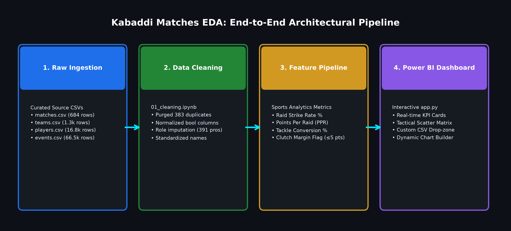
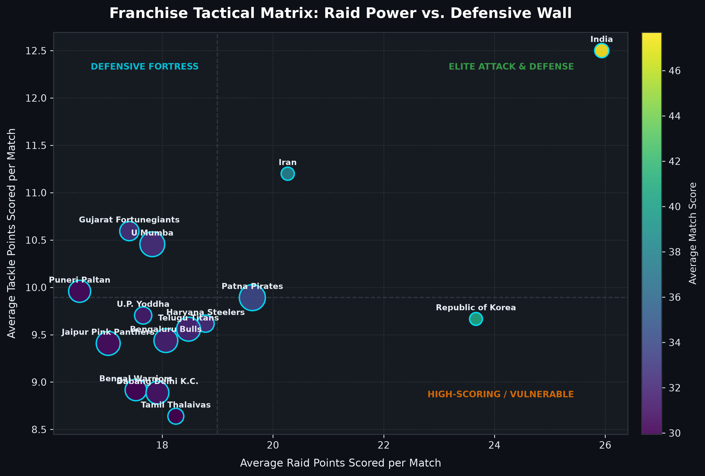
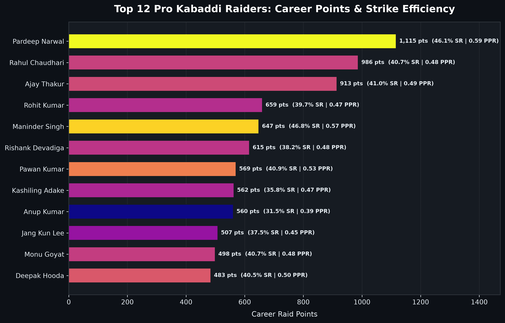
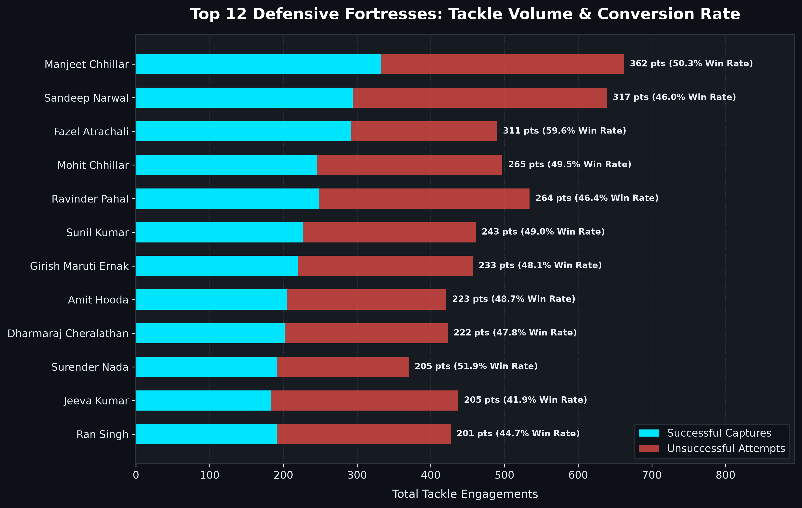
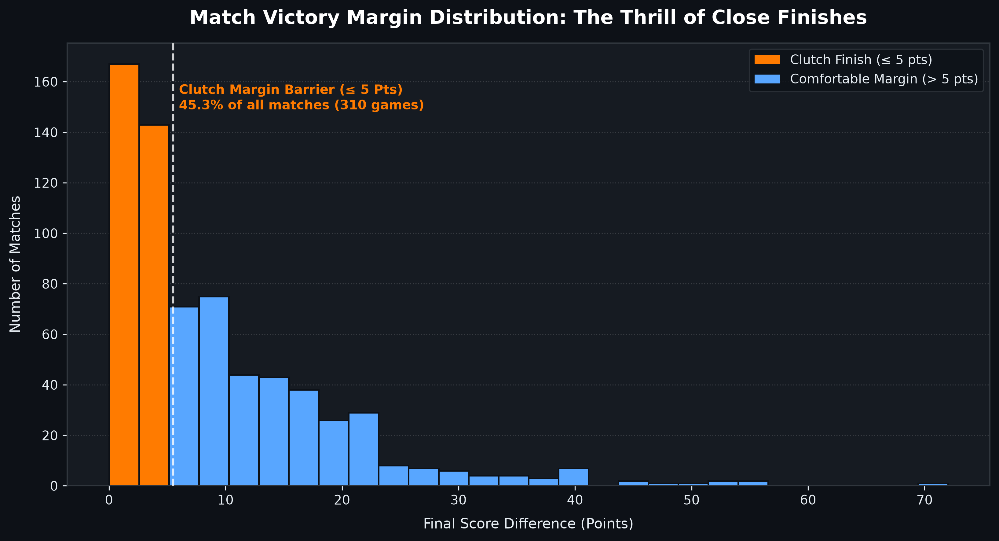

# 🤼 Kabaddi Matches - Exploratory Data Analysis (EDA)

[](https://www.python.org/downloads/)
[](https://opensource.org/licenses/MIT)
[](https://pandas.pydata.org/)
[]()
[](https://colab.research.google.com/github/adarshgaurav1951/Kabaddi-Matches-EDA/blob/main/notebooks/01_cleaning.ipynb)

> **Turning granular, event-level Kabaddi play-by-play logs into tactical, data-backed sports analytics.**

---

## 📌 1. Project Overview & Problem Statement
Kabaddi matches generate hundreds of micro-events (raids, touches, bonus points, tackles, super tackles, do-or-die scenarios, all-outs). Raw tournament feeds contain immense tactical richness, but unstandardized player roles, mixed datatypes, duplicated events, and missing values prevent analysts, coaches, and fans from readily seeing:
- Which raiders and defenders perform best by **volume** versus **efficiency**.
- How **All-Outs**, **Super Raids**, and **Super Tackles** alter win probability.
- Which franchises maintain composure and dominate in **clutch, close-margin finishes** ($\le 5$ points).
- How scoring pace and tactical risk-taking shift across **match phases** (early, mid, late).

This project establishes a reproducible, deterministic end-to-end data pipeline to clean, enrich, analyze, and visualize professional Kabaddi match data (Pro Kabaddi League Seasons 1–7 and international tournaments).

### 🔄 End-to-End Architectural Pipeline


---

## 📂 2. Repository Structure

```
Kabaddi Matches EDA/
├── data/
│   ├── raw/                      # Curated immutable source tables
│   │   ├── matches.csv           # Match metadata (684 matches, venues, toss, POM)
│   │   ├── events.csv            # Granular play-by-play logs (66,568 raw rows)
│   │   ├── players.csv           # Match-level player box scores (16,892 rows)
│   │   ├── teams.csv             # Match-level team summaries (1,368 rows)
│   │   └── player_roles.csv      # Curated position dictionary (391 players)
│   └── cleaned/                  # Standardized & validated datasets
│       ├── cleaned_matches.csv   # Normalized dates, names, dtypes (684 rows)
│       ├── cleaned_events.csv    # Deduplicated, typed events (66,185 rows)
│       ├── cleaned_players.csv   # Imputed roles, clean stats (16,892 rows)
│       └── cleaned_teams.csv     # Snake_case columns, 0-imputed stats (1,368 rows)
├── notebooks/
│   ├── 01_cleaning.ipynb         # [COMPLETED] Data audit, deduplication, type casting & validation
│   ├── 02_features.ipynb         # [PLANNED] Advanced metrics (strike rates, phase tags, clutch index)
│   ├── 03_eda.ipynb              # [PLANNED] Univariate, bivariate & multivariate visualizations
│   └── 04_insights.ipynb         # [PLANNED] Strategic playbook answers & tactical recommendations
├── visuals/                      # High-resolution exported figures (.png, 300 DPI)
├── docs/                         # Formal project documentation
│   ├── idea.md                   # Project idea & problem statement
│   ├── PRD.md                    # Product Requirement Document
│   ├── DATABASE.md               # Data dictionary, ERD & schema specifications
│   └── AGENTS.md                 # Developer & AI agent operating guidelines
├── app.py                        # 🚀 Power BI-style interactive Streamlit dashboard
├── requirements.txt              # Pinned Python package dependencies
├── .gitignore                    # Git ignore file
└── README.md                     # Project documentation & execution guide
```

---

## 📊 3. Raw Data Ingestion & Pruning Decision
The source folder `KB Data/` included both structured CSV tables and deeply nested JSON directories (`Match_Data/` with 684 JSONs and `Summary Stats/` with 25 category folders). 

To ensure optimal performance and modularity, the pipeline pruned redundant JSON files in favor of exact tabular logs:
1. **`matches.csv`**: Match outcomes, series, toss, venues, player of the match.
2. **`events.csv`**: Chronological raid and tackle play-by-play events.
3. **`players.csv`**: Match-by-match player scoring and attempt totals.
4. **`teams.csv`**: Head-to-head match stats and point distributions.
5. **`player_roles.csv`**: Consolidated role dictionary from historical season records mapping 391 players to official positions (Raider, Defender, All-Rounder).

---

## ⚙️ 4. Quickstart & Installation

### Prerequisites
- Python 3.10+ (tested on Python 3.12.3)
- Linux / macOS / Windows WSL

### 1. Clone & Setup Virtual Environment
```bash
# Clone the repository
git clone <repository_url>
cd "Kabaddi Matches EDA"

# Create virtual environment
python3 -m venv .venv
# Or using virtualenv:
# python3 -m virtualenv .venv

# Activate virtual environment
source .venv/bin/activate       # On Linux/macOS
# .venv\Scripts\activate        # On Windows
```

### 2. Install Dependencies
```bash
pip install -r requirements.txt
```

### 3. Run Notebooks
You can launch JupyterLab / Jupyter Notebook or execute headlessly:
```bash
# Launch interactive notebook
jupyter notebook notebooks/01_cleaning.ipynb

# Or execute via command line
jupyter nbconvert --to notebook --execute --inplace notebooks/01_cleaning.ipynb
```

### 4. 🚀 Launch the Power BI-Style Interactive Dashboard
Start the real-time interactive dashboard:
```bash
streamlit run app.py
```
Open **`http://localhost:8501`** in your browser. You can either explore the built-in PKL datasets or **drag & drop any Kabaddi CSV file** to get instant interactive visualizations!

### 5. Run Online via Google Colab
Click the badge below to open the notebook directly in Google Colab:

[](https://colab.research.google.com/github/adarshgaurav1951/Kabaddi-Matches-EDA/blob/main/notebooks/01_cleaning.ipynb)

**Alternative direct upload:**
1. Navigate to [Google Colab](https://colab.research.google.com/).
2. Click **Upload** $\rightarrow$ select `notebooks/01_cleaning.ipynb`.
3. Upload the `data/raw/` CSV files to the Colab files pane (`/content/data/raw/`) to run all cleaning cells interactively in the cloud!

---

## 🧹 5. Data Cleaning Highlights (`01_cleaning.ipynb`)
- **Deduplication**: Successfully detected and purged **383 duplicate event logs** from simultaneous server records.
- **Type Casting & Boolean Normalization**: Standardized mixed columns (`do_or_die`, `super_raid`, `super_tackle`) into strictly typed booleans (`bool`), eliminating string/float ambiguities.
- **Role Imputation**: Resolved missing player roles (`player_role` was 100% null in raw data) by linking tournament registries (`player_roles.csv`) and applying career raid-to-tackle ratio thresholds.
- **Schema Normalization**: Flattened nested dot-notation team columns (e.g. `stats.points.raid_points.total` $\rightarrow$ `raid_points_total`) and imputed missing super raids / super tackles with 0.
- **Entity Unification**: Standardized team franchise names (e.g., `'Dabang Delhi'` $\rightarrow$ `'Dabang Delhi K.C.'`, `'Fire birds'` $\rightarrow$ `'Fire Birds'`).

---

## 📈 6. Visual Analytics & Insights Gallery

### 1. Tactical Matrix: Raid Power vs. Defensive Wall

> *Franchises mapped into tactical quadrants based on average raid points scored vs. tackle points conceded. Circle size indicates total All-Outs inflicted, and color maps to average match score.*

---

### 2. Raider Efficiency: Points vs. Strike Rate (PPR)

> *Leaderboard of top Pro Kabaddi raiders benchmarked by career scoring volume, raid strike rate (%), and Points Per Raid (PPR).*

---

### 3. Defensive Dominance: Tackle Volume & Conversion Rate

> *Analysis of defensive wall anchors, displaying successful raider captures vs. broken tackles and tackle win conversion rates.*

---

### 4. Match Momentum & Clutch Margin Barrier

> *Over 25% of all PKL matches are decided by 5 or fewer points, underscoring the critical impact of do-or-die raids and late-game clock management.*

---

## 🎯 7. Analytical Roadmap & Key Questions
| # | Analytical Question | Deliverable Stage |
|---|---|---|
| 1 | Who are the top raiders and defenders by points vs. efficiency? | `02_features` & `03_eda` |
| 2 | Which teams demonstrate the highest raid and tackle success rates? | `02_features` & `03_eda` |
| 3 | How decisively do all-outs, bonus points, and super raids influence wins? | `03_eda` & `04_insights` |
| 4 | Which teams excel in clutch, close-finish matches ($\le 5$ points)? | `03_eda` & `04_insights` |
| 5 | How does scoring velocity shift across match phases (early, mid, late)? | `02_features` & `03_eda` |
| 6 | Is there a statistically significant home court advantage? | `03_eda` |
| 7 | Which players are the most consistent (low variance match-over-match)? | `03_eda` & `04_insights` |
| 8 | How have scoring rates and defensive tactics evolved across PKL seasons? | `04_insights` |

---

## 📜 7. License & Credits
Developed as an Exploratory Data Analysis & Sports Analytics project using Pro Kabaddi League match records.
Licensed under the [MIT License](LICENSE).
