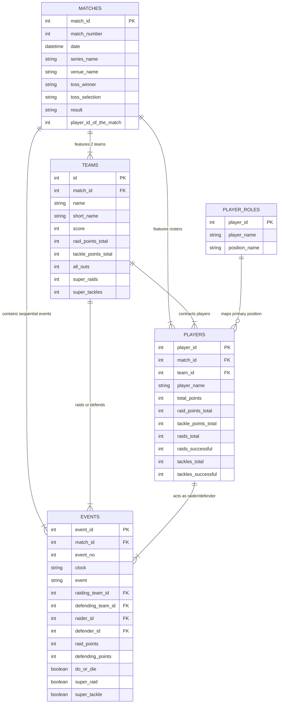

# Database & Data Schema Specification

## 1. Overview & Architecture
This document specifies the database design, schema definitions, entity relationships, and column dictionaries for the **Kabaddi Matches EDA** project.

The dataset models professional Kabaddi matches (primarily Pro Kabaddi League Seasons 1 through 7, plus international invitationals). The relational model links matches, competing teams, participating players, and event-by-event raid and tackle actions.

---

## 2. Table Specifications

### 2.1 `matches` (`data/raw/matches.csv` $\rightarrow$ `data/cleaned/cleaned_matches.csv`)
Captures match-level context, location, tournament series, and final outcomes.

| Column Name | Raw Type | Cleaned Type | Nullable | Description & Domain Rules |
|---|---|---|---|---|
| `match_id` | `int64` | `int32` | No | Unique identifier for each match (PK). |
| `match_number` | `int64` | `int16` | No | Sequence number of the match within the tournament. |
| `date` | `object` | `datetime64[ns]` | No | Match calendar date (normalized from MM/DD/YYYY). |
| `start_time` | `object` | `string` | Yes | Scheduled match start time (e.g. "20:00"). |
| `series_id` | `int64` | `int16` | No | ID for tournament/season. |
| `series_name` | `object` | `string` | No | Name of competition (e.g., "Pro Kabaddi League Season 7, 2019"). |
| `status` | `object` | `category` | No | Match completion status ("Finished", etc.). |
| `result` | `object` | `string` | Yes | Result summary string (e.g. "Bengaluru Bulls beat U Mumba (34-32)"). |
| `toss_winner` | `object` | `string` | Yes | Team name that won the pre-match coin toss. |
| `toss_selection` | `object` | `category` | Yes | Decision chosen by toss winner ("Court" or "Raid"). |
| `venue_id` | `int64` | `int16` | No | Identifier of the stadium/venue. |
| `venue_name` | `object` | `string` | No | Stadium and city name (e.g., "Gachibowli Indoor Stadium, Hyderabad"). |
| `player_id_of_the_match` | `float64` | `Int32` | Yes | Player ID awarded Player of the Match (foreign key). |
| `player_name_of_the_match`| `object` | `string` | Yes | Player name awarded Player of the Match. |
| `home_team_id` | `float64` | `Int32` | Yes | Designated home franchise ID (null for neutral/tournaments). |
| `home_team_name` | `object` | `string` | Yes | Designated home franchise name. |

---

### 2.2 `events` (`data/raw/events.csv` $\rightarrow$ `data/cleaned/cleaned_events.csv`)
Atomic raid and tackle play log. Each row represents a raid, tackle, card, or timeout event.

| Column Name | Raw Type | Cleaned Type | Nullable | Description & Domain Rules |
|---|---|---|---|---|
| `event_id` | `int64` | `int64` | No | Unique transaction ID for the play (PK). |
| `match_id` | `int64` | `int32` | No | Match reference ID (FK to `matches`). |
| `event_no` | `int64` | `int16` | No | Sequential chronological ordering of the event within match. |
| `clock` | `object` | `string` | Yes | Match clock countdown (MM:SS format, e.g. "19:42"). |
| `event` | `object` | `category` | No | Play classification: 'Successful Raid', 'Empty Raid', 'Unsuccessful Raid', 'Substitution', 'TimeOut', 'Green Card', 'Yellow Card', 'Red Card'. |
| `event_text` | `object` | `string` | Yes | Natural language play-by-play commentary log. |
| `raiding_team_id` | `float64` | `Int32` | Yes | Team ID on the attack (FK). |
| `defending_team_id` | `float64` | `Int32` | Yes | Team ID defending the court (FK). |
| `raider_id` | `float64` | `Int32` | Yes | Player ID crossing into opposition half (FK). |
| `defender_id` | `float64` | `Int32` | Yes | Primary defending player making tackle or conceded touch. |
| `defenders` | `mixed` | `Int8` | Yes | Number of defenders standing on court (1 to 7). |
| `raid_points` | `float64` | `int8` | No | Total raid points earned on this raid ($[0, 8]$). Default 0. |
| `raid_touch_points` | `float64` | `int8` | No | Points from physical tags on defenders ($[0, 7]$). Default 0. |
| `raid_bonus_points` | `float64` | `int8` | No | Bonus points crossed past bonus line ($0$ or $1$). Default 0. |
| `raid_all_out_points` | `float64` | `int8` | No | Points awarded for inflicting an All-Out (usually 2 points). |
| `defending_points` | `float64` | `int8` | No | Total points earned by defense on this play ($[0, 2]$). Default 0. |
| `defending_capture_points`| `float64`| `int8` | No | Points for successfully tackling raider ($1$ or $2$ for Super Tackle). |
| `do_or_die` | `mixed` | `boolean` | No | Indicator if raid is a 3rd successive empty raid requiring a point. |
| `super_raid` | `mixed` | `boolean` | No | Indicator if raider scores $\ge 3$ points in one raid. |
| `super_tackle` | `mixed` | `boolean` | No | Indicator if defense captures raider with $\le 3$ defenders on court. |

---

### 2.3 `players` (`data/raw/players.csv` $\rightarrow$ `data/cleaned/cleaned_players.csv`)
Player match box score summarizing volume and point generation per game.

| Column Name | Raw Type | Cleaned Type | Nullable | Description & Domain Rules |
|---|---|---|---|---|
| `player_id` | `int64` | `int32` | No | Unique player ID (PK). |
| `match_id` | `int64` | `int32` | No | Foreign key to `matches`. |
| `team_id` | `int64` | `int32` | No | Foreign key to `teams`. |
| `player_name` | `object` | `string` | No | Cleaned full name of player. |
| `player_played` | `bool` | `boolean` | No | True if player took part in match action. |
| `player_captain` | `bool` | `boolean` | No | Team captain flag. |
| `player_total_points` | `int64` | `int16` | No | Sum of raid points + tackle points. |
| `player_raid_points_total`| `int64` | `int16` | No | Total raid points scored in match. |
| `player_raids_total` | `int64` | `int16` | No | Total raid attempts made in match. |
| `player_raids_successful` | `int64` | `int16` | No | Number of point-scoring raid attempts. |
| `player_raids_unsuccessful`| `int64`| `int16` | No | Number of raids resulting in being caught out. |
| `player_raids_Empty` | `int64` | `int16` | No | Number of safe zero-point raid attempts. |
| `player_tackle_points_total`|`int64` | `int16` | No | Total tackle points scored in match. |
| `player_tackles_total` | `int64` | `int16` | No | Total tackle attempts engaged. |
| `player_tackles_successful` |`int64` | `int16` | No | Number of successful raider captures. |
| `player_tackles_unsuccessful`|`int64`| `int16` | No | Number of failed/broken tackle attempts. |
| `player_green_card` | `int64` | `int8` | No | Warning cards received. |
| `player_yellow_card`| `int64` | `int8` | No | 2-minute suspension cards received. |
| `player_red_card` | `int64` | `int8` | No | Match ejection cards received. |

---

### 2.4 `teams` (`data/raw/teams.csv` $\rightarrow$ `data/cleaned/cleaned_teams.csv`)
Team match summary metrics. Exactly 2 records per match.

| Column Name | Raw Type | Cleaned Type | Nullable | Description & Domain Rules |
|---|---|---|---|---|
| `id` | `int64` | `int32` | No | Team ID (PK). |
| `match_id` | `int64` | `int32` | No | Foreign key to `matches`. |
| `name` | `object` | `string` | No | Official team franchise name. |
| `short_name` | `object` | `string` | Yes | 3-4 letter abbreviation (e.g., "BEN", "MUM"). |
| `score` | `int64` | `int16` | No | Final team score in match. |
| `stats.points.raid_points.total` | `float64` | `int16` | No | Total raid points earned by team. |
| `stats.points.tackle_points.total`| `float64` | `int16` | No | Total tackle points earned by team. |
| `stats.points.all_out` | `float64` | `int16` | No | Points gained from inflicting all-outs ($2 \times \text{all-outs}$). |
| `stats.points.extras` | `float64` | `int16` | No | Technical / penalty points awarded. |
| `stats.raids.total` | `float64` | `int16` | No | Total raids attempted by team. |
| `stats.raids.successful` | `float64` | `int16` | No | Successful raid attempts. |
| `stats.raids.super_raids` | `float64` | `int8` | No | Number of super raids achieved. |
| `stats.tackles.total` | `float64` | `int16` | No | Total tackle attempts initiated. |
| `stats.tackles.successful` | `float64` | `int16` | No | Successful tackles executed. |
| `stats.tackles.super_tackles` | `float64` | `int8` | No | Super tackles completed. |

---

## 3. Data Integrity & Cleaning Transformation Rules
1. **Deduplication:** Check exact duplicates on compound keys:
   - Matches: `match_id`
   - Teams: `(match_id, id)`
   - Players: `(match_id, player_id)`
   - Events: `(match_id, event_no)`
2. **Standardization of Team Names:** Resolve franchise renaming and casing discrepancies:
   - "Dabang Delhi" $\rightarrow$ "Dabang Delhi K.C."
   - "Fire birds" $\rightarrow$ "Fire Birds"
   - Strip leading/trailing whitespaces.
3. **Data Type Coercion:** All point counters with missing values must be imputed with 0 and downcast to signed/unsigned integers (`int16`, `int8`).
4. **Boolean Normalization:** In `events`, columns like `do_or_die`, `super_raid`, `super_tackle` have mixed entries (`'True'`, `'False'`, `0`, `1`, `NaN`). Convert all to boolean (`True`/`False`), treating `NaN` as `False`.
