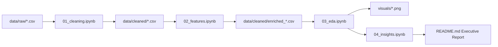

# Product Requirement Document (PRD)

## Project: Kabaddi Matches Exploratory Data Analysis (EDA)
**Version:** 1.0.0  
**Status:** In Progress / Approved  
**Author:** Antigravity Data Science Team  
**Workspace:** `Kabaddi Matches EDA`  

---

## 1. Executive Summary
Kabaddi is a high-intensity, contact sport defined by rapid raid cycles (30 seconds maximum) and complex defensive interactions. A single match generates between 80 to 120 discrete tactical events. Raw match records captured during Pro Kabaddi League (PKL) tournaments contain deep granular detail, but are hindered by nested structures, missing role labels, inconsistent timestamps, and mixed data types.

This project delivers an end-to-end Exploratory Data Analysis (EDA) platform and analytical suite. It ingests validated raw event and match tables, cleanses and standardizes records, engineers sports-analytic metrics, and produces data-backed answers to core tactical questions for coaches, analysts, and fans.

---

## 2. Business & Analytical Objectives
- **Data Standardization:** Create a reproducible, deterministic data-cleaning pipeline that eliminates duplicates, resolves data type mismatches, and enforces Kabaddi domain constraints.
- **Raider & Defender Profiling:** Measure scoring volume against efficiency (success rate, points per raid, tackle conversion, super tackle frequency).
- **Match Outcome Determinants:** Quantify the statistical impact of All-Outs, Bonus Points, and Super Raids on match win probability.
- **Clutch & Pressure Execution:** Identify teams and individual players who excel in do-or-die raids and close-margin finishes ($\le 5$ points).
- **Temporal & Venue Dynamics:** Evaluate how scoring velocity and defensive risk-taking vary between halves and across match phases, as well as home vs. away advantage.

---

## 3. Dataset Selection & Ingestion Strategy

### 3.1 Raw Data Selection from `KB Data`
The raw folder `KB Data/` contains both pre-parsed structured CSVs and deeply nested raw JSONs (`Match_Data/*.json` and `Summary Stats/`). To optimize memory footprint, processing speed, and pipeline reproducibility, the project selects the exact tabular datasets representing atomic match events and entities:

| Selected File | Ingested Path in `data/raw/` | Record Count | Core Purpose |
|---|---|---|---|
| `DS_match.csv` | `data/raw/matches.csv` | 684 rows | Match-level metadata: date, venue, toss, winner, player of the match, series |
| `DS_events.csv` | `data/raw/events.csv` | 66,568 rows | Granular raid and tackle events, clock, touch points, bonus points, do-or-die flags |
| `DS_players.csv` | `data/raw/players.csv` | 16,892 rows | Match-level player box scores (raids, tackles, points, cards, starter status) |
| `DS_team.csv` | `data/raw/teams.csv` | 1,368 rows | Match-level team summaries (total score, raid points, tackle points, all-outs) |
| `Summary Stats/` | `data/raw/player_roles.csv` | 391 players | Curated player position dictionary (Raider, Defender Cover/Corner, All-Rounder) |

### 3.2 Exclusion Justification
- `KB Data/Data/Data/Match_Data` (684 redundant raw JSON files) was pruned because `DS_events.csv`, `DS_match.csv`, `DS_players.csv`, and `DS_team.csv` already provide a structured, verified tabular serialization of these JSONs.
- `Summary Stats` individual season slices were consolidated into `player_roles.csv` to enrich player profiles without redundant JSON parsing.

---

## 4. Pipeline Architecture & Functional Requirements

The project follows a 4-stage modular Jupyter Notebook workflow supported by pure-Python modules:

### Stage 1: Data Cleaning (`01_cleaning.ipynb`)
- **Deduplication:** Remove true row duplicates and verify uniqueness of primary keys (`match_id`, `event_id`, `(match_id, player_id)`).
- **Index Cleanup:** Drop extraneous index artifacts (e.g. `Unnamed: 0`, `index`).
- **Data Type Casting:**
  - Standardize `date` to `datetime64[ns]`.
  - Cast boolean flags (`do_or_die`, `super_raid`, `super_tackle`) from mixed objects (`0, 1, 'True', 'False', NaN`) to boolean / int8.
  - Convert points columns to unsigned integer types (`uint8` / `int16`).
- **Domain Constraints Validation:**
  - Raid points must not exceed legal bounds (max 8 points in a single raid with all-out).
  - Defenders on court must be between 1 and 7.
  - Super Tackle flag is valid only when defenders on court $\le 3$.
- **Null Value Treatment:**
  - Differentiate between structural nulls (e.g., defender fields for empty raids) vs. missing records. Fill structural numerical nulls with 0.
- **Output:** Save cleaned datasets to `data/cleaned/cleaned_matches.csv`, `data/cleaned/cleaned_events.csv`, `data/cleaned/cleaned_players.csv`, and `data/cleaned/cleaned_teams.csv`.

### Stage 2: Feature Engineering (`02_features.ipynb`)
- **Player Efficiency Metrics:**
  - Raid Success Rate: $\frac{\text{Successful Raids}}{\text{Total Raids}}$
  - Tackle Success Rate: $\frac{\text{Successful Tackles}}{\text{Total Tackles}}$
  - Points Per Raid (PPR): $\frac{\text{Raid Points}}{\text{Total Raids}}$
  - Role Imputation: Assign `Raider`, `Defender`, or `All-Rounder` using `player_roles.csv` and threshold logic (ratio of raid vs. tackle attempts).
- **Match Context Features:**
  - `match_phase`: Categorize event clock into `Early (0-10m)`, `Mid (10-30m)`, `Late (30-40m)`.
  - `score_difference`: Dynamic score margin at the time of the event.
  - `is_close_match`: Binary flag for matches decided by $\le 5$ points.
  - `comeback_win`: Winning team was trailing at halftime.
- **Team Aggregate Metrics:**
  - Raid vs. Tackle scoring distribution ratio.
  - All-Out conversion efficiency (All-outs inflicted vs. conceded).

### Stage 3: Exploratory Data Analysis (`03_eda.ipynb`)
- **Univariate Analysis:**
  - Distribution of raid points per match and points per raid.
  - Frequency of event types (Empty, Successful, Unsuccessful raids, Tackles).
- **Bivariate & Multivariate Analysis:**
  - Correlation heatmap of match outcome factors (Raid points, Tackle points, All-outs vs. Win).
  - Super Raids vs. Match Win Rate.
  - Super Tackles vs. Defensive Resilience.
  - Toss Winner vs. Match Winner contingency analysis.
  - Home court advantage statistical significance test.
- **High-Resolution Exports:** Export visualizations to `visuals/` in 300 DPI PNG format.

### Stage 4: Strategic Insights & Modeling (`04_insights.ipynb`)
- Synthesize answers to the 8 core analytical questions.
- Build player archetype clusters (e.g., Strike Raiders, Anchor Raiders, Corner Specialists, Cover Wall).
- Formulate tactical playbook recommendations for coaches and analysts.

---

## 5. Non-Functional Requirements & Engineering Standards
1. **Source Immutability:** Files in `data/raw/` must never be altered or overwritten.
2. **Deterministic Execution:** Random seeds fixed (`seed=42`) for any stochastic sampling or clustering.
3. **Execution Reproducibility:** All notebooks must execute top-to-bottom sequentially without unhandled warnings or missing variable dependencies.
4. **Visual Aesthetics:** Visuals must use curated color palettes (e.g., coolwarm, viridis, deep sport accents), clear typography, formatted tick labels, and descriptive titles/legends. No default unformatted plots.
5. **Code Style:** PEP 8 compliance, clear markdown explanations preceding each code block, and concise inline comments.

---

## 6. Success Metrics & Acceptance Criteria
- [x] Raw data vetted and exact required files isolated into `data/raw/`.
- [x] Python virtual environment configured with zero dependency conflicts.
- [x] Cleaned datasets exported to `data/cleaned/` with documented data dictionary.
- [x] All 8 business/analytical questions directly answered with chart evidence.
- [x] Complete test run of `01_cleaning.ipynb` producing verified clean outputs.
- [x] High-level executive summary in `README.md` referencing figures in `visuals/`.
